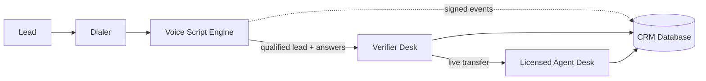

# Case Study: Insurance Call-Center CRM & Voice Script Engine

> **Note:** Code is proprietary to a former employer and is not included. This
> write-up describes my role and the engineering involved.

## 1. Overview

A multi-tenant CRM for an insurance call-center workflow, built around a
two-stage sales flow: a **verifier** confirms a lead's details, then hands the
live call to a **licensed agent** who can sell. Leads arrive already qualified
by a rule-based voice script engine. It asks a short set of recorded questions,
classifies each answer, and transfers interested leads to the verifier queue.

This was a team project. I owned the parts of the workflow listed below and
contributed alongside the wider team on the rest.

## 2. What I worked on

**Built by me:**

- **Verifier and licensed-agent workspaces** with live call transfers between
  the two stages
- **Pre-filled verification forms**, populated from the answers the voice
  script captured, so verifiers confirm the details instead of re-asking
- **Hot-lead alerts** that surface qualified leads to the floor in real time,
  with **routing only to agents licensed for the lead's state**
- **Signed event forwarding** between services: HMAC-signed payloads,
  idempotent upserts on the receiving side, and retry with exponential backoff
  so a lead is never silently dropped

**Team work I contributed alongside:**

- Suppression (do-not-call) list, web lead intake and versioned question sets
- QA flags, seat and permission management, and agent onboarding with
  licence checks
- The rule-based voice script: recorded prompts, speech recognition,
  classification of answers into branches, and a recording disclosure at the
  start of every call

## 3. Architecture

The voice script engine never writes to the CRM directly. Its results travel
as signed events, so the CRM has a single, authenticated way in no matter what
called the lead.

## 4. Engineering practices

- **Multi-tenancy:** every business record is scoped to an organization, and
  the database enforces that boundary rather than relying on each query to
  remember it.
- **Infrastructure as code:** containerised services, a pinned and
  reproducible toolchain, and build and deployment pipelines defined as code.
- **Continuous integration:** lint, type checks, builds and integration tests
  run against a real database on every change.
- **Latency budgets for real-time voice:** the gap between a caller finishing a
  sentence and the next prompt starting was treated as a hard budget, measured
  and recorded on every turn.

## 5. Compliance areas the system was designed for

- **Suppression lists:** anyone who asks not to be called again is excluded
  before dialing.
- **Recording disclosure:** played first on every call and logged per call,
  so it can be proven afterwards.
- **Licence-based routing** *(built by me)*: a lead only reaches an agent
  licensed to sell in that lead's state.
- **Consent records:** designed to support consent records.

## 6. What I learned

- **Push business rules down to where they can't be bypassed.** Rules enforced
  in the database hold for every client, including ones not written yet.
- **Delivery needs to be "at least once" plus idempotent.** Acknowledge only
  after storing, and make repeats harmless. That's simpler than trying to
  deliver exactly once.
- **Handoffs are product design.** A verifier who opens a pre-filled form spends
  the call confirming instead of re-asking, and the lead notices.
- **Compliance is a design input.** Building disclosure and suppression in
  from the start costs days. Adding them later costs far more.
